# herdr-pane

### 選一個編號，把 agent 接進目前的終端。

`herdr-pane` 是 Herdr 的第三方命令列輔助工具：把本機目前 session 與已啟用遠端連線的 agent 整理成編號清單，選取後核對目標，再接上原本的單一終端。

**Herdr 本身已有跨機 agent 清單、遠端連線與 session 共享。** 本工具補的是「在目前 pane 選號、直接接上單一 agent」的操作流程，沒有新增 SSH 權限或多人協作協定；也不是 Herdr 官方專案。

> **版本：0.1.0，供試用。** 程式可執行，29 項自動測試通過，已在 macOS 驗證本機／遠端清單與 SSH attach／detach。Linux、正式 staging、新帳號與 MFA 全流程尚未實測。



## 適合什麼情境

- 保留目前工作畫面，把另一台機器上的 agent 接進旁邊的 pane。
- 在一般終端快速列出可用 agent，不想手動找 terminal ID、組 SSH 與 session 參數。
- 把原本寫死個人主機設定的啟動腳本，換成使用者各自的 Herdr profile。

如果你主要在 Herdr 視窗裡切換 agent，原生側欄與 Goto 搜尋通常更方便。本工具的清單是快照，需要手動刷新；沒有做操作時間的對照測量，不宣稱一定比較快。詳見 [與原生 Herdr 的比較](docs/native-comparison.md)。

## 安裝與快速開始

需要：

- Python 3.9 以上、Herdr、OpenSSH client，以及已取得的遠端 SSH 存取。
- macOS；程式亦以 Linux／POSIX 為目標，但 Linux 尚未實測。原生 Windows 不在本版支援範圍。
- 已測組合：本機 Herdr 0.9.5、遠端 server 0.9.1。沒有額外 Python 套件或 jq 依賴。

下載後可先不安裝，直接試用：

```sh
git clone https://github.com/peitang/herdr-pane.git
cd herdr-pane
python3 herdr_pane.py --version
python3 herdr_pane.py --list
python3 herdr_pane.py
```

要安裝正式指令：

```sh
mkdir -p "$HOME/.local/bin"
install -m 755 herdr_pane.py "$HOME/.local/bin/herdr-pane"
herdr-pane --version
```

若 `~/.local/bin` 尚未加入 PATH，先用 `~/.local/bin/herdr-pane` 執行，或在目前 shell 執行 `export PATH="$HOME/.local/bin:$PATH"`。依自己的 shell 設定持久保存；工具不修改 shell 設定檔。

更新時在此 checkout 執行 `git pull --ff-only`，再重跑上面的 `install`。移除程式使用 `rm "$HOME/.local/bin/herdr-pane"`；這只移除啟動器，不會刪除 Herdr profile 或停止 agent。

## 日常使用

```sh
herdr-pane              # 顯示清單，輸入編號接上
herdr-pane --list       # 只列出，不連線
herdr-pane --timeout 5  # 每個查詢最多等待 5 秒
```

清單列出主機、session、agent 類型／名稱、狀態與目錄。輸入編號連線，`r` 刷新，直接 Enter 離開。

編號只屬於當次互動清單，不支援跨次執行的 `herdr-pane 1`。每筆遠端 profile 對應一個 session；不會自動掃描所有主機或所有 session。預設只列 agent，不列一般 shell。

接上後用 `Ctrl+B` 再按 `Q` detach。巢狀 Herdr 的前綴鍵可能先被外層接收，詳見 [疑難排解](docs/troubleshooting.md)。

## 第一次設定遠端

建議先使用 Herdr 原生引導；0.9.5 能探索執行中的 session：

```sh
herdr machine add build-box
herdr-pane
```

也保留同一入口的引導參數：

```sh
herdr-pane --add-remote
herdr-pane --add-remote build-box --remote-session review
```

本工具會詢問 SSH 位置與 session，再交給 `herdr machine add`。它明確指定 session，**沒有原生 0.9.5 的 session 自動探索選單**。名稱不存在時，原生流程可能建立並啟動新 session；請確認名稱並自行回答 SSH 驗證、安裝或替換 server 的提示。`build-box` 與 `review` 都是示範名稱。

完整步驟見 [首次連線指南](docs/connection-guide.md)。

## 移除或停用遠端

使用 Herdr 原生命令，將 `PROFILE_ID` 換成清單中的 `id`：

```sh
herdr machine list --json
herdr machine disable PROFILE_ID  # 暫時停用，保留設定
herdr machine enable PROFILE_ID   # 重新啟用
herdr machine remove PROFILE_ID   # 移除這筆儲存的連線
```

停用或移除不會停止遠端 session／agent。重新執行 `herdr-pane`，或在選單按 `r`，即可刷新結果。

## 文件導覽

| 內容 | 文件 |
| --- | --- |
| 與原生功能重疊、增量與取捨 | [功能比較](docs/native-comparison.md) |
| 啟動、選號、連線與離開 | [完整操作流程](docs/workflows.md) |
| 新使用者設定 SSH 與 session | [首次連線指南](docs/connection-guide.md) |
| 錯誤處理、驗證與巢狀快捷鍵 | [疑難排解](docs/troubleshooting.md) |
| 分享權限與機敏資料邊界 | [安全說明](docs/security.md) |
| 已驗證與尚待驗證的情境 | [驗收清單](docs/acceptance.md)／[驗證紀錄](docs/document-review.md) |
| 四張流程圖及可編輯原稿 | [SVG 與 Mermaid](docs/diagrams/README.md) |

## Detail items

清單查詢並行處理，單一來源失敗不取消其他結果。選號後重新核對 profile、session、pane 與 terminal ID，拒絕失效目標。本機以程序關係核對呼叫端，避免接到自己；不依賴其他 client 的焦點。

## Related functions

底層沿用 `herdr agent list`、`herdr machine list --json`、`herdr --machine <profile> agent list`、`herdr terminal attach` 與原生 `herdr machine add`。程式不建立第二套主機設定或憑證儲存。

## Test results

```sh
python3 -m unittest discover -s tests -v
```

29 項測試涵蓋多來源清單、設定／目標變更、逾時與取消、參數及顯示文字處理、選單快照與新增遠端委派。SSH 連線與正常 detach 另以隔離終端實測。完整範圍與未測項目見 [驗證紀錄](docs/document-review.md)。

## New components

單一可安裝程式 `herdr_pane.py`、標準 unittest 測試、操作文件與四張 SVG／Mermaid 流程圖。沒有新增背景服務或自動化部署。

## Reference

- [Herdr 官方文件](https://herdr.dev/tui/docs/)
- [Herdr 0.9.5 多機連線](https://raw.githubusercontent.com/herdrdev/herdr/v0.9.5/docs/next/website/src/content/docs/connecting-machines.mdx)
- [Herdr 0.9.5 CLI](https://raw.githubusercontent.com/herdrdev/herdr/v0.9.5/docs/next/website/src/content/docs/cli-reference.mdx)

## Notes

接上的終端可以輸入，沒有強制唯讀或細分授權；對方仍須自行取得 SSH 存取。同一個終端僅有一個 writable direct attach 擁有者，接上可能改變 pane 尺寸。本工具不自動 takeover 或重連；Herdr 完整 client 的多人觀看能力不等於多個 direct attach 擁有者。

本專案程式與文件採 [MIT 授權](LICENSE)。Herdr、Python 與 OpenSSH 需另行安裝，不包含在本 repository。
