# 首次連線指南

> 這是預定引導流程。`herdr-pane` 尚未發布；Herdr 的原生命令則可依安裝版本的說明使用。



## 準備什麼

- 本機具備相容的 Herdr、OpenSSH client 與 JSON 處理工具。
- 能透過既有內網、VPN 或其他已核准的網路路徑到達遠端。
- 已取得遠端主機的合法 SSH 存取；使用自己的金鑰或該環境要求的驗證方式。
- 知道 SSH 別名或 SSH 位置，例如 `build-box`、`developer@build.example.invalid`。

所有範例都是虛構的；`.invalid` 網域不能作為實際連線目標。

## 引導的使用方式

```sh
# 尚未知道參數格式時，由工具逐步詢問
herdr-pane --add-remote

# 已有 SSH 別名
herdr-pane --add-remote build-box

# 直接提供帳號與主機
herdr-pane --add-remote developer@build.example.invalid
```

預定引導的邏輯階段如下；原生畫面的出現順序依 Herdr 版本而定，尚未做端到端驗收：

1. **輸入位置**：取得 SSH 別名或目標；已有參數時沿用，不重複詢問。
2. **檢查輸入**：拒絕空白值、控制字元與不支援格式；不把輸入當 shell 程式執行。
3. **交由 Herdr 原生流程處理**：呼叫 `herdr machine add <ssh_target>`，保留互動式 SSH 驗證與主機金鑰確認。
4. **確認 session**：支援互動選擇的版本可沿用原生流程；其他版本須明確指定 `--remote-session <name>`，或清楚告知使用 default。一筆 profile 對應一個 session。
5. **檢查遠端 Herdr**：必要的安裝、更新或替換詢問，必須由使用者自行決定，工具不可自動回答。原生新增流程會確認並啟動所選的遠端背景 server；這一步會改變遠端執行狀態。
6. **確認結果**：成功才重新讀取儲存的 profile；不從顯示名稱推算 profile ID。
7. **回到選單**：列出新增遠端中的 agent，和本機 agent 一起編號。

取消任一步驟，回到原本的選單或離開引導。原生新增若失敗，不自行寫入一筆看似完成的設定。

## 常見結果

| 畫面或結果 | 使用者下一步 | 工具應如何處理 |
| --- | --- | --- |
| 尚未設定遠端 | 執行 `--add-remote`，也可先用本機 | 正常列出本機 |
| SSH 主機名稱無法解析 | 檢查別名、DNS 與網路 | 顯示可讀錯誤，不修改設定 |
| 密碼、金鑰密語或 MFA | 在原生 SSH 畫面完成 | 不記錄、不代填、不寫進文件 |
| 未知／變更的主機金鑰 | 依組織流程核對主機身分 | 不關閉 host-key checking |
| 沒有相容的遠端 Herdr | 在原生詢問中決定是否安裝 | 不做無人確認的安裝或升級 |
| 要求停止／替換執行中的 server | 未安排維護時取消，保留工作 | 不自動答應、不重啟 session |
| profile 名稱重複 | 依原生流程提供不同標籤 | 不覆蓋既有連線 |
| 設定成功但沒有 agent | 先在該 session 啟動 agent，再刷新 | 顯示空清單，不宣告連線失敗 |
| 非互動 shell 找不到 Herdr | 修正安裝位置或指定受支援位置 | 探索已知安裝路徑，失敗時明確報錯 |

## 連線設定與憑證各自存放

- Herdr profile 保存連線名稱、SSH 目標與 session 等連線資訊。
- SSH 金鑰、密碼管理與主機信任交由原生 SSH／系統機制管理。
- `herdr-pane` 不建立第二套密碼儲存格式，也不要求將現有 SSH 設定上傳到 repository。
- 分享工具本身不會授予存取權。能否看見 agent，仍取決於連線者已有的權限。

## 已有 SSH 別名的使用者

以下僅為自行設定的範例，不能直接拿來連線：

```sshconfig
Host build-box
    HostName build.example.invalid
    User developer
```

有自訂埠號、代理、金鑰或驗證政策時，沿用自己的 SSH 設定，不在啟動器內寫死環境專屬值。

## 原生功能依據

Herdr 0.9.5 的 `machine add` 文件描述互動式 session 選擇；0.9.1 文件則描述 default 與明確的 `--remote-session` 參數。兩者都可能在設定時啟動遠端背景 server，並在需要替換執行中 server 時詢問使用者。參考 [0.9.5 文件](https://raw.githubusercontent.com/herdrdev/herdr/v0.9.5/docs/next/website/src/content/docs/connecting-machines.mdx) 與 [0.9.1 文件](https://raw.githubusercontent.com/herdrdev/herdr/v0.9.1/docs/next/website/src/content/docs/connecting-machines.mdx)。不同版本字串本身不代表一定需要替換 server；應檢查實際相容能力。
