# 操作流程

> 0.2.1 操作流程。圖表說明行為；測試涵蓋範圍另見 [驗證紀錄](document-review.md)。

## 1. 日常使用：啟動、選號、接上

### 開啟選單

1. 執行 `herdr-pane`。
2. 檢查必要工具與終端環境。缺少依賴時，列出缺少項目與處理方式。
3. 查詢本機目前 session 的 agent；取得已啟用的遠端連線清單。
4. 顯示查詢提示，並行查詢最多八個來源。查詢中的清單不開放編號選取，避免編號持續變動。
5. 每個遠端在有限時間內回報成功、無 agent 或錯誤。某台失敗不取消其他來源。
6. 查詢完成或達到期限後，形成當次清單並固定編號，才開放輸入。

沒有遠端設定時，直接使用本機清單，另提示可以執行 `herdr-pane --add-remote`。沒有任何 agent 時，顯示空清單原因與刷新／離開選項，不進入連線流程。

本機 server 未啟動或無法查詢時，標示本機不可用，繼續列出可用遠端；一般查詢不自動啟動本機 server。

### 選單內容

| 欄位 | 用途 |
| --- | --- |
| 編號 | 本次選單的操作入口；不能當永久識別碼 |
| 主機 | 區分本機與不同遠端連線 |
| Session | 有同主機的多個 session 時，用來消除歧義 |
| Agent／名稱 | 類型與可辨認名稱；沒有名稱時使用 pane 識別碼 |
| 狀態 | 保留 Herdr 回報的狀態；未知不等於閒置 |
| 目錄 | 協助辨認專案；終端控制字元應先清理 |

預設列 agent，不把純 shell 或未辨識的終端直接標成 agent。透過本機程序祖先與 `pane process-info` 核對呼叫端，排除確認為自己的終端，選取時再次核對。選取遠端時也核對目標程序，PID 重疊時追加同機探測；程序資訊查詢失敗時拒絕連線。不以繼承的 pane ID 或其他 client 焦點猜測。tmux 等會切斷祖先關係的用法不在本版自我辨識支援範圍，詳見疑難排解。

### 選號後再次核對

1. 使用者輸入清單編號；空白 Enter 取消，非數字或超出範圍則重新輸入。
2. 從當次快照取出連線 profile、session、pane 與 terminal 識別碼。
3. 在相同來源重新查詢，確認該 agent 與終端仍存在、對應未變。
4. 目標已離開、被替換或無法確認時，說明原因並重新列出；不能自動改接同名 agent。
5. 顯示即將連線的主機、session 與 agent，再進入該終端。

名稱與 pane 編號可以在不同機器上重複。內部識別至少包含「機器連線＋session＋pane」，連線前另核對 terminal 識別碼；不能單憑顯示名稱找第一筆符合者。

### 本機與遠端走不同連線路徑

- **本機**：在選取的本機 session 中呼叫 Herdr 終端連線。
- **遠端**：使用相同 profile 的 SSH 目標與 session 執行遠端 Herdr，連到已核對的終端。

清單查詢與實際連線必須共用同一份 profile。不得一邊查詢 named session，另一邊卻連到 default session。

所有命令參數都應透過安全的參數傳遞與引用處理；SSH 位置、名稱、目錄、session 等資料不能交給 `eval`。

接上 direct attach 會使用連線者的終端尺寸，可能改變該 pane 的顯示大小。共享觀看者應預期畫面重排；這不是固定尺寸的畫面串流。

## 2. 首次設定遠端

完整流程與圖表見 [首次連線指南](connection-guide.md)。新增成功後重新取得連線清單，回到選單；取消或失敗則保留原有可用來源。

## 3. 正常離開與連線異常

| 情況 | 預定行為 |
| --- | --- |
| 正常 detach | 使用 Herdr 的離開操作；結束本次連線，不觸發自動重連 |
| agent 結束／終端關閉 | 顯示目標已結束，回到重新查詢的選單 |
| 另一個 direct attach 已占用 | 顯示占用狀態，返回選單；本版不提供 takeover 參數 |
| 被其他人 takeover | 不自動重連或搶回；若原生 attach 沒自行返回，以 detach 離開 |
| 遠端網路暫時中斷 | 提示中斷，回到選單；使用者可重新選號連線 |
| 驗證失敗／主機金鑰問題 | 提示使用標準 SSH 流程處理後，再重新選號 |
| 使用者按 Ctrl+C | 取消查詢或等待，不停止遠端 server |

Herdr 文件描述的 detach 操作是 `Ctrl+B` 後按 `Q`。若在另一層 Herdr 中使用，前綴鍵可能先被外層接收；實作驗收須確認各種巢狀情境的按鍵說明，不能假設所有層都收到同一組按鍵。

### 自動重連仍需驗證

第一版的設計基準是回到選單，由使用者重新選號。自動重連不是目前承諾的功能：斷線後舊 direct attach 可能仍占用終端，必須先實測釋放時機及被接管的結果，再決定是否加入有限重試。

- 不能只看到 SSH 結束碼 `255` 就判定是暫時網路問題；驗證及主機金鑰錯誤也可能回傳此狀態。
- 重新選號仍須重新查詢並核對目標，不能沿用已失效的編號。
- 已被接管時不搶回操作權；要交接操作，先由雙方協調並使用原生工具確認狀態。
- 原生 Herdr 的 direct attach 擁有者限制，不是所有 API 與 TUI 操作的全域輸入鎖。

## 4. 分享給其他人

每個使用者在自己的電腦安裝必要工具，設定自己的 SSH 存取，再執行 `herdr-pane --add-remote`。遠端位址與金鑰設定留在使用者的 SSH／Herdr 設定中。

要接上相同的既有工作，連線必須指向同一主機、同一個有權存取該 session 的帳號與同一 session。不同帳號不會因為 session 同名就自動共用。

本方案不新增帳號、不擴大 SSH 權限，也不把私鑰打包分送。共享可操作終端的權限範圍，見 [安全與發布檢查](security.md)。

## 5. 指令與編號

只提供 `herdr-pane` 正式入口，不保留舊名稱。

跨次執行的數字不應當作穩定目標。新版的編號操作限定在同一次互動選單內；自動化若有需要，應另以明確目標設計介面。

## 參考

- [Herdr agent、session 與多 client 的定義](https://raw.githubusercontent.com/herdrdev/herdr/v0.9.1/docs/next/website/src/content/docs/concepts.mdx)
- [Direct attach 與 detach 的原生行為](https://raw.githubusercontent.com/herdrdev/herdr/v0.9.1/docs/next/website/src/content/docs/persistence-remote.mdx)

## 移除儲存的遠端連線

`herdr-pane --remove-remote` → 列出全部儲存的 profile（包含停用）→ 選號 → 顯示目標與影響 → 輸入 `yes` → 重新核對設定 → 原生 `machine remove` → 確認 ID 已消失 → 結束。

也可用 `--remove-remote PROFILE_ID` 省略選號；兩種方式都要確認。Enter 取消，設定中途改變就停止，移除失敗不顯示成功。操作只查本機儲存的 profile，不需要連上遠端；本機 client 會與該連線斷開，遠端 session 與 agent 保留。暫時隱藏請用 `herdr machine disable PROFILE_ID`。
